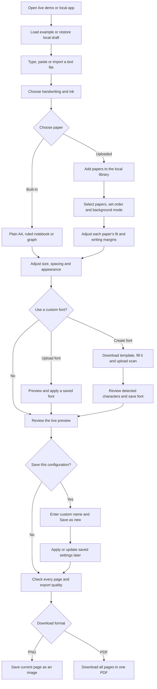
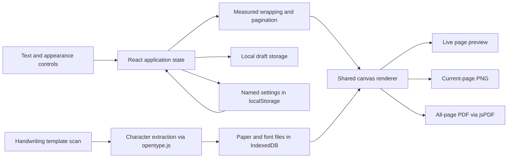
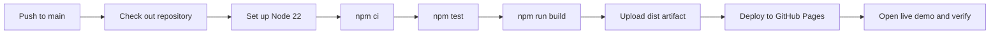

# Inkify AI — Text to Handwriting

Turn typed text into handwritten A4 notebook pages. Choose handwriting, ink and paper, fine-tune the layout, save named settings, and download PNG or PDF files. The React application processes your notes in your browser.

**[Try the live demo](https://naveenrajamoni89-lab.github.io/inkify-your-Handwriting/)** · **[Source code](https://github.com/naveenrajamoni89-lab/inkify-your-Handwriting)** · **[Deployment status](https://github.com/naveenrajamoni89-lab/inkify-your-Handwriting/actions)**

No installation or sign-in is required to try the live website.

## Contents

- [Quick live test](#quick-live-test)
- [Complete usage flow](#complete-usage-flow)
- [Step-by-step guide](#step-by-step-guide)
- [Run locally](#run-locally)
- [Project structure](#project-structure)
- [How the application works](#how-the-application-works)
- [Testing](#testing)
- [Deployment](#deployment)
- [Storage and privacy](#storage-and-privacy)
- [Limits and troubleshooting](#limits-and-troubleshooting)

## Quick live test

1. Open **[Inkify live](https://naveenrajamoni89-lab.github.io/inkify-your-Handwriting/)** and wait for the handwriting preview to appear.
2. In **Your text**, replace the example with a few sentences and give your notebook a title.
3. Choose a handwriting style and ink color. Check that the preview changes.
4. Open **Make it yours**, set **Exact line spacing** to `30`, and try **Tight** or **Extra tight**.
5. Under **MY SAVED SETTINGS**, enter `My compact notes` and click **Save as new**.
6. Change the spacing, choose your saved settings, and click **Apply settings**. Your saved values should return.
7. Refresh the page. Your draft and saved settings should still be available in the same browser.
8. Click **Save PNG** for the current page or **Download PDF** for all pages. Open the file to check the result.

For a multipage test, paste several paragraphs and use the preview page selector before exporting the PDF.

## Complete usage flow



## Step-by-step guide

### 1. Add your notes

- Use **Your text** to type or paste notes, or choose **Import .txt** for a plain-text file smaller than 200 KB.
- Change **Notebook title** to set the exported filename.
- Text input supports up to 50,000 characters. **Try an example** replaces the editor text with the sample note.
- The app wraps text and creates pages automatically. Use the arrows or page selector to review each page.

### 2. Choose handwriting and appearance

The **Handwriting Style** cards provide Research notes, Everyday, Neat & tidy, and Journal styles. Saved custom fonts appear alongside them.

Open **Make it yours** to choose a built-in preset or change letter size, weight, slant, width, spacing, word gaps, rotation, ink intensity and stroke thickness. You can also choose a paper finish, underline headings, and enable connected writing.

**Connected writing** uses the selected font's native word shaping and ligatures. Individual-letter spacing and per-letter variation apply in individual-letter mode. **Natural handwriting effects** controls the size, baseline and ink variation.

### 3. Reduce line spacing

| Control | What it does |
| --- | --- |
| Line spacing slider | Sets the baseline distance between lines from 12 to 100 px. |
| Exact line spacing | Lets you enter the spacing directly instead of dragging the slider. |
| Comfortable | Sets spacing to approximately 1.3 times the current letter size. |
| Tight | Sets spacing equal to the current letter size. |
| Extra tight | Sets spacing to approximately 0.8 times the current letter size, with a 12 px minimum. |
| Letter size | Reduces the letters themselves; supports 12–64 px. Reapply a spacing shortcut after changing size if desired. |
| Baseline irregularity and character rotation | Reduce these to make tightly spaced writing steadier. They do not change the baseline distance. |

There is no hidden font-size floor overriding your spacing choice. Very tight lines can overlap tall letters and descenders; review the preview before exporting. The same spacing calculation is used for pagination, preview and exports.

### 4. Save settings with a custom name

In **Make it yours → MY SAVED SETTINGS**:

1. Adjust the appearance you want to keep.
2. Enter a **Custom name**, such as `Exam notes` or `Compact journal`.
3. Click **Save as new** to create a named configuration.
4. Choose a configuration from **Saved settings** and click **Apply settings** to restore it.
5. To change an existing configuration or its name, select it, edit the settings or name, then click **Update selected**.
6. Click **Delete selected** to remove that configuration.

Named settings include handwriting, spacing, ink, export quality, general paper settings and a reference to the custom font, if selected. They do not include your note text or duplicate uploaded paper/font files. Each uploaded paper retains its own fit settings separately. If a referenced font or paper is unavailable, the app uses a fallback and tells you.

Settings are stored in the current browser and site address. They do not sync between devices.

### 5. Use custom paper or notebook backgrounds

1. Under **CUSTOM BACKGROUND / PAPER**, click **Add papers to library**.
2. Upload PNG, JPG or WebP images, up to 15 MB and 40 megapixels per image. The library holds up to 10 papers.
3. Check the saved papers you want to use and click **Use selected papers**. Unchecking keeps a paper in the library; **Delete saved paper** removes it.
4. Use the arrows to reorder selected papers.
5. Choose **Alternate selected papers** to cycle through them, or **Use the same paper** to repeat the first selected paper.
6. On each paper, choose whole-image fit, cropped fill or stretch. Adjust its top, bottom, left and right writing margins.
7. Use **Fit writing to full page** for a fresh full-page fit, or adjust the preview guide and **Auto-adjust edges**. Review the result and correct the margins manually when needed.
8. Check every page before downloading. The preview identifies the current paper and background mode.

New uploads append to the library. A batch larger than the remaining capacity is rejected; delete unused papers or upload fewer files. Images are resized to at most 3508 pixels on their longest edge. Existing handwriting in an uploaded image remains visible beneath the new text.

### 6. Upload or create your own handwriting font

**Upload an existing font:** open **My handwriting** or **Custom Font Manager**, upload a WOFF, WOFF2, TTF or OTF file up to 5 MB, preview it, and choose **Apply to notes**. You can rename, download or delete saved fonts.

**Create a font from your handwriting:**

1. Open the font manager's template creation tab.
2. Download the handwriting template and fill the labeled character cells.
3. Scan it flat, crop to the complete template page at a 6:7 ratio, and upload a PNG or JPEG smaller than 20 MB.
4. Adjust **Ink threshold** and click **Re-detect characters** if necessary.
5. Review the detected cells, exclude unwanted marks, then build and save the font.
6. Apply the saved font to your notes.

The template covers 94 characters. Missing characters use browser fallback. This process requires the supplied grid; it does not extract a matching font from arbitrary handwritten paragraphs.

### 7. Export and share

Choose export quality under **Make it yours**:

| Quality | Image size per A4 page | Use |
| --- | --- | --- |
| 150 DPI | 1240 × 1754 px | Smaller files and everyday sharing |
| 300 DPI | 2480 × 3508 px | Higher-resolution output for printing |

- **Save PNG** downloads the currently selected preview page.
- **Download PDF** includes every generated page in one A4 document.
- PDFs contain lossless raster page images; the handwriting is not selectable text.
- Custom-paper exports omit added page numbers. The writing-area guide is preview-only.

## Run locally

Use Node.js 22 for the same major version as the deployment workflow. The package also permits Node 20.19+ within Node 20, or Node 22 and later.

```sh
git clone https://github.com/naveenrajamoni89-lab/inkify-your-Handwriting.git
cd inkify-your-Handwriting
npm ci
npm run dev
```

Open the local URL printed by Vite, usually `http://127.0.0.1:5173`. No backend, API key or environment file is required.

| Command | Purpose |
| --- | --- |
| `npm ci` | Install the exact dependency versions from the lockfile. |
| `npm run dev` | Start the local development server. |
| `npm test` | Run the Node layout and paper-library tests. |
| `npm run build` | Compile the production website into `dist/`. |
| `npm run preview` | Serve the compiled build locally, usually on port 4173. |

## Project structure

```text
inkify-your-Handwriting/
├── .github/
│   └── workflows/
│       └── deploy.yml          # Test, build and deploy to GitHub Pages
├── public/
│   └── favicon.svg             # Website icon
├── src/
│   ├── main.jsx                # Application UI, state, pagination and exports
│   ├── engine.js               # Settings, text layout and canvas rendering
│   ├── SavedSettings.jsx       # Named settings: save, apply, update and delete
│   ├── PaperControls.jsx       # Uploaded paper library and fit controls
│   ├── WritingGuide.jsx        # Preview writing-area handles and edge adjustment
│   ├── paper-library.js        # Paper selection, ordering and fit data helpers
│   ├── paper-store.js          # Persistent paper library and image loading
│   ├── FontManager.jsx         # Font upload, preview and template interface
│   ├── font-store.js           # Persistent font storage and activation
│   ├── template.js             # Template creation, extraction and font building
│   └── style.css               # Application styles and responsive layout
├── tests/
│   ├── engine.test.js          # Layout, spacing, rendering helpers and restoration
│   ├── paper-library.test.js   # Paper library selection and lifecycle tests
│   └── browser.mjs             # Optional Chromium interaction and export checks
├── index.html                  # HTML entry point and page metadata
├── vite.config.js              # Relative asset paths for static hosting
├── package.json                # Commands, runtime requirements and dependencies
├── package-lock.json           # Locked dependency versions
├── .gitignore                  # Excludes dependencies and generated/local files
└── README.md
```

`node_modules/`, `dist/`, `.npm-cache/` and `.browser-check/` are local/generated directories and are excluded from Git.

## How the application works

The stack uses React 19, Vite 6, browser Canvas, bundled Fontsource fonts, Lucide icons, jsPDF and opentype.js.



The engine shares line spacing and glyph measurements between layout and rendering. Seeded variation keeps the same content and settings consistent across repeated renders. Built-in fonts load from bundled assets. Template extraction converts detected ink runs into OpenType outlines.

## Testing

Run the automated unit tests and production build:

```sh
npm test
npm run build
```

The tests cover wrapping without losing characters, paragraph preservation, tight-spacing pagination, draft normalization, seeded variation, custom-paper placement and paper selection/order behavior.

For the optional browser suite, use Node 22+ and an installed Chromium browser. Start `npm run dev` in another terminal, then run:

```powershell
# Windows PowerShell: adjust the path if necessary.
$env:BROWSER_PATH = 'C:\Program Files\Google\Chrome\Application\chrome.exe'
node tests/browser.mjs
```

```sh
# macOS/Linux: replace the executable path for your system.
BROWSER_PATH=/path/to/chromium node tests/browser.mjs
```

The browser suite checks rendering, controls, font persistence, synthetic template extraction, PNG/PDF output, draft recovery and mobile overflow. It creates an isolated browser profile and stores artifacts in the ignored `.browser-check/` directory. Run it against the development server: its template check imports a source module that is not exposed by the production build.

Use the [quick live test](#quick-live-test) to check the published application manually, including named settings.

## Deployment

The live deployment is **[https://naveenrajamoni89-lab.github.io/inkify-your-Handwriting/](https://naveenrajamoni89-lab.github.io/inkify-your-Handwriting/)**.

In the repository, set **Settings → Pages → Build and deployment → Source** to **GitHub Actions**. The tracked workflow runs on pushes to `main` and can also be started manually from Actions.



The workflow requests read access to repository contents, write access to Pages, and an identity token for deployment. Only one Pages deployment runs at a time.

For another static host, use `npm run build` and publish `dist/`. Relative asset URLs support both repository subpaths and root hosting. Publish the compiled output: serving the source `index.html` directly leaves its JSX entry point unbuilt. `npm run preview` is for local verification of the build.

## Storage and privacy

| Data | Storage and behavior |
| --- | --- |
| Text, title and current settings | Browser localStorage; draft autosaves after a short delay. |
| Named configurations | Browser localStorage; saved explicitly with a custom name. |
| Custom fonts | Browser IndexedDB; activated again when available. |
| Paper images, selections, order and per-paper fit | Browser IndexedDB; restored on the same site address. |
| PNG and PDF exports | Downloaded to the location chosen by your browser. |

The application does not send your notes, uploaded fonts or paper images to an application backend. Loading the hosted website still requests its static assets from the hosting provider. There are no user accounts or cross-device synchronization. Clearing browser/site data removes locally stored drafts and libraries; export important work first. Local development and the live site have separate storage.

## Limits and troubleshooting

| Problem or limit | What to do or expect |
| --- | --- |
| Blank site after deployment | Check Actions, confirm Pages uses GitHub Actions, and publish `dist/` rather than the unbuilt source. |
| Old controls after an update | Wait for the latest deployment to succeed, then refresh the page. |
| Handwriting fonts fail to load | Reload the page and check the network connection and browser console. |
| Saved settings or files are missing | Use the same browser and site address. Site-data clearing and private browsing can remove storage. |
| Text overlaps at small line spacing | Increase spacing, reduce letter size, or reduce rotation and baseline irregularity. |
| Writing is outside an uploaded sheet | Adjust that paper's fit and margins. Edge adjustment is a starting point; it does not straighten a photographed page. |
| Paper library is full | Delete unused papers before uploading more; the limit is 10. |
| Custom font does not connect letters | Connected writing depends on the font's available shaping and ligatures. |
| Template font has missing characters | Re-scan the supplied grid, adjust ink threshold, and review the cells. Unsupported characters use fallback. |
| Export uses too much memory | Choose 150 DPI or export a shorter note. Large 300-DPI documents require more memory. |

Reference-inspired handwriting is a visual approximation, not an exact handwriting clone. Template extraction does not perform general handwriting recognition, perspective correction or smooth outline tracing. Real alternate glyphs require a font with supported alternate tables; the app does not invent them. Static fonts may use synthesized weights. Paragraph breaks, punctuation and capitalization are preserved, while runs of whitespace normalize to single spaces.
